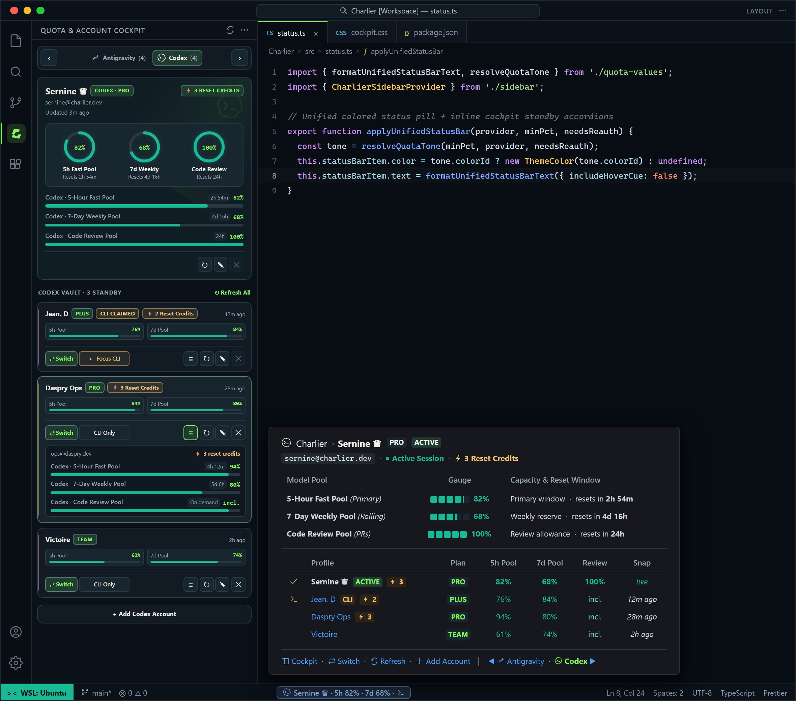

<div align="center">

<br/>


# Charlier

**Run multiple Codex & Antigravity CLI accounts at the exact same time. Hot-swap IDE accounts in `~100ms` without ever restarting the VS Code Extension Host.**

*One pinned IDE Hero + unlimited parallel CLI accounts + live burn telemetry across Windows, macOS, and Linux. Zero runtime npm dependencies.*

<p>
  <a href="#cross-os-architecture"></a>
  <a href="#cross-os-architecture"></a>
  <a href="#cross-os-architecture"></a>
</p>
<p><sub>&middot;&nbsp;&nbsp;&nbsp;&middot;&nbsp;&nbsp;&nbsp;&middot;</sub></p>
<p>
  
  
  <a href="https://marketplace.visualstudio.com/items?itemName=Sernine.charlier"></a>
  <a href="https://open-vsx.org/extension/Sernine/charlier"></a>
</p>

</div>

<p align="center">
  
  
</p>

---

## Cut One Card. Keep the Whole Table Running.

Google Antigravity and OpenAI Codex were built assuming one login per machine. Every existing VS Code switcher just accepts that wall and throws a sledgehammer at your editor. Charlier broke both limits:

1. **Multi-Account CLI Concurrency (Supposed to Be Impossible)**: Normally, running two `codex` or `agy` accounts at the same time on one machine is impossible because both bind to a single global `~/.codex/auth.json`, `~/.gemini/`, and OS keyring entry. Charlier turns that into a single click: keep **Account A pinned in your IDE** while spawning **Accounts B, C, and D concurrently** in isolated integrated terminals via [`CLI Only` Mode](#multi-window--cli-concurrency-cli-only-mode). Each terminal boots in its own sandboxed home (`~/.gemini/charlier/cli-homes/`) with OS keyring bypass and automatic rotated-token sync-back. Zero collision.
2. **Surgical Single-Provider Hot-Swap (Zero Extension Host Restart)**: Every other VS Code switcher calls `workbench.action.restartExtensionHost` or `reloadWindow` to apply an account change, nuking the entire extension rail: your language servers, debuggers, MCP servers, terminals, and every co-running AI assistant drop at once. Charlier never touches the rest of VS Code. It grafts only `codex app-server`'s `ChildProcess` stdio stream in memory (`~100ms` with a 3-stage `account/updated` router reset) or respawns only the current window's `agy` language-server PID (`~800ms`, protected by a `2`-in-`10m` surgical budget guard before upstream's 3-restart `process_exit_nonzero` wall). Only the single provider you clicked reloads. Everything else keeps running.
3. **Sub-Second Speed & Live Burn Telemetry**: Swaps finish before your hand leaves the mouse (`~100ms` Codex / `~800ms` Antigravity), and the Cockpit + Status Bar stay live while you work: real-time `account/rateLimits/updated` + `turn/completed` push on Codex, post-turn loopback daemon sync on Antigravity, `60s` active + `CLI CLAIMED` burn ticks while focused, and `5m` standby vault pulls without ever hitting manual Reload.

```text
OTHER SWITCHERS (Nuke the Entire Extension Rail)
  [Click Switch] ──> restartExtensionHost() / reloadWindow()
                       ├── [X] Antigravity dropped
                       ├── [X] Codex dropped
                       ├── [X] Claude / Kimi / LSPs / Debuggers / MCP servers killed
                       └── 3s-8s cold reboot  |  strictly 1 account at a time

CHARLIER (Cut Only the Card You Touched, Run the Whole Deck)
  [Click Switch] ──> Codex: ~100ms in-memory stdio graft  |  Antigravity: ~800ms local daemon respawn
                       ├── IDE Hero swaps cleanly (sibling AI extensions & LSPs stay live)
                       └── [CLI Only] ──> Terminal B (Account B) + Terminal C (Account C) + Terminal D (Account D)
                                          all running in parallel inside isolated per-profile sandboxes
```

Named after the **Charlier pass**: the classic one-handed card cut that brings the bottom half of the deck cleanly to the top. Built under **Sernine**.

---

## How Charlier Compares

| Capability | Charlier | Typical Account Switchers | Manual Sign-Out / Sign-In |
| :--- | :--- | :--- | :--- |
| **Parallel CLI + IDE Accounts (`CLI Only`)** | **Yes** - run `codex --no-daemon` and `agy` on multiple accounts simultaneously while IDE Hero stays pinned | **No** - global single-account lock; clobbers IDE login or collides in OS keyring | Manual env juggling |
| **Single-Provider Surgical Hot-Swap** | **Yes** - restarts ONLY the provider you clicked (`~100ms` stdio graft / `~800ms` window-scoped daemon respawn); sibling AI extensions, LSPs, and debuggers stay live | **No** - kills the entire VS Code Extension Host rail and drops every running agent | Full browser OAuth roundtrip |
| **Switch Latency** | **`~100ms` (Codex) / `~800ms` (Antigravity)** | `3s-8s` full Extension Host or window reload | `30s-60s` browser login + callback |
| **Live Burn Auto-Refresh & Standby Telemetry** | **Yes** - real-time turn push + `60s` focused active & `CLI CLAIMED` updates + `5m` direct HTTPS standby pulls + clock rollover | **No** - stale until manual reload, and blind to inactive accounts | **No** |
| **Revocation-Safe Swaps & Auto-Save** | **Yes** - never fires server-side `account/logout`; auto-saves unsaved IDE sessions before switch; serialized Codex RTR lock | **No** - invalidates sibling sessions or burns single-use refresh tokens | **No** |
| **Multi-Provider in One Vault** | **Google Antigravity + OpenAI Codex** *(Claude & Kimi co-run aware, full vaults on roadmap)* | Single provider only | Separate logins everywhere |
| **Runtime Footprint & Win32 Security** | **0 npm deps**, zero PowerShell spawns, zero unsigned `.exe` droppers (**15 KB `#![no_std]` Rust N-API**) | Heavy SQLite WASM bundles, inline PowerShell scripts, or unsigned helpers | N/A |

---

## What It Ships

### 1. Night Cut Cockpit & Unified Status Bar Overlay
- **Single-Surface Colored Status Bar Pill**: One unified status bar pill (`priority: 501`) with a single click target (`QuickPick`, including one-click `workbench.hover.delay` tuning) and an instant hover matrix. Uses Charlier's theme-adaptive <picture><source media="(prefers-color-scheme: light)" srcset="media/providers/antigravity-inline-forest-64.png" /></picture> **Antigravity** (mint `#92D6BE`) and scalloped <picture><source media="(prefers-color-scheme: light)" srcset="media/codex/codex-small-cobalt-64.png" /></picture> **Codex** (ice-blue `#8DBCF6`) provider marks, keeping `>_` dedicated cleanly to active CLI terminals, and shifts tone by health (amber `#E8BA6F` warning at `15-49%` or `VERIFY NEEDED`, crimson `#E88585` critical at `1-14%`, error background at `0%` depletion or `RE-AUTH`, plus a trailing `>_` badge with active count whenever background `CLI Only` terminals are running).
- **Tier-Aware Antigravity Color Health**: Codex tints by the tighter of its global `5h` and `7d` pools. Antigravity computes a tier-aware average across active pools (`FREE`: Gemini; `ULTRA`: Gemini + Claude/GPT + standalone Carbon if provisioned; `PRO`: Gemini + Claude/GPT + Argon + standalone Carbon when Google turns it on) so one low Pro Argon reserve does not paint your entire pill red while Gemini and Claude are healthy.
- **Lower-Panel Hover Matrix & Gemini 4 Carbon Readiness**: Hovering the Status Bar pill opens a multi-account comparison table (`Profile | Plan | Gemini | [Claude] | Argon | Carbon | Snap` on Antigravity; `Profile | Plan | 5h Pool | 7d Pool | Review | Snap` on Codex) with 1-click row switching. Antigravity's `Carbon` column already ships ready for Gemini 4 Carbon: `ULTRA` shows `incl.` (bundled with Argon inside the Ultra pool), `PRO` displays `--` while standby, and both the Cockpit and Hover Matrix pick up live Pro Carbon buckets automatically whenever Google enables them.
- **CLI Claimed Visibility & Priority Sorting**: Profiles running in an isolated terminal via `CLI Only` surface across every view: a compact `>_` indicator (plus terminal count when multiple are open) on the Status Bar pill, a terminal marker and amber `CLI` pill in the Hover Matrix row, and `CLI CLAIMED` + `>_ Focus CLI` in the Cockpit. To stop active terminal sessions from getting buried behind idle high-tier standby accounts, Charlier overrides strict tier sort to pin the **Active** account first and float all **`CLI CLAIMED`** profiles right below it inside the Hover Matrix's 4-row cap (overflowing extra standby profiles cleanly to `+ N more in Cockpit`). Clicking a claimed row lets you focus its running terminal instead of spawning colliding duplicates.
- **Best Standby Smart Failover (`NEXT UP`)**: When your active session drops into critical reserve (`< 15%`), exhausts a primary pool (e.g., `< 15%` Claude/GPT even while Gemini & Argon remain high), or requires **`RE-AUTH`** / **`VERIFY NEEDED`**, Charlier picks the strongest unclaimed healthy standby in memory (`< 0.1ms`) using **Healthy-Tier Bands**: healthy paid tiers win by plan rank first (e.g., `Ultra 50%` beats `Pro 100%`; Antigravity requires `Gemini >= 50%` and `Claude >= 25%`), low paid tiers (`15-49%`) yield to healthy paid tiers (`Pro 100%` beats `Ultra 20%`) while still beating `Free 100%`, and `Free`-only pools sort by max headroom. Surfaces a one-click **`⇄ Switch Best`** pit-stop banner + **`NEXT UP`** card badge in Cockpit, clickable **`Best Standby`** + **`NEXT`** pills in the Hover Matrix, and `$(zap) NEXT UP` in QuickPick.
- **Plan-Tier Sorting, Inactive-Only Delete Guard & Keyboard Search**: Remaining standby profiles sort automatically by plan tier (`ULTRA > ENTERPRISE > PRO > TEAM > EDU > PLUS > API_KEY > FREE`), breaking ties by recency. Standby cards include collapsible `≡` accordion drawers for `5h`/`7d` reset countdowns, Code Review Pool (`Included` / `On demand` / live `%`), and `reset credits`, while active IDE Hero and `CLI CLAIMED` delete icons (`✕`) remain disabled with guidance tooltips to avoid post-delete re-detection loops. Once a deck reaches `6+` accounts, sticky search filters live (`/` focuses search, `Esc` clears).
- **Live Burn Auto-Refresh & Zero-Flicker Retained Sync**: Watch what you burn in real time without touching **Refresh All** or reloading. Codex applies live `account/rateLimits/updated` pushes straight off `codex app-server` stdout at `0ms` (plus `turn/completed` fallback), Antigravity refreshes its local loopback daemon right after conversation activity settles, and a focus-aware tiered loop (`charlier.autoRefreshInterval`, default `60s`, paused when unfocused with automatic focus/Cockpit-open catch-up and Linux Wayland interaction liveness) keeps your **Active Hero** and running **`CLI CLAIMED`** terminals live every `60s` while refreshing unclaimed standby accounts gently every `5m` (reusing valid tokens and reading `CLI CLAIMED` Codex homes strictly read-only so single-use RTR never collides). The Cockpit webview stays alive (`retainContextWhenHidden`) with sequence-guarded `postMessage` sync recovery so deck flips, live burn ticks, tier changes, and `CLI Only` claim updates reconcile smoothly in place without document teardown reloads, dial re-spins, `full -> empty -> full` oscillation, or idle lower-panel blinks.

### 2. Revocation-Safe Swaps, Google Verification Gate & Honest `STALE` Telemetry
- **Startup & Background OAuth Heartbeat**: On activation and refresh, Charlier validates both active and dormant credentials against Google Cloud Code (`oauth2.googleapis.com` / `v1internal`) and OpenAI Codex (`auth.openai.com/oauth/token` / `wham/usage`), deduplicating rapid probes and backing off failed attempts automatically.
- **Google Post-Login Verification Gate Awareness (`VERIFY NEEDED`)**: When Google gates a newly signed-in or standby Antigravity account behind phone/QR verification (`VALIDATION_REQUIRED` / `403 PERMISSION_DENIED: "Verify your account to continue"`), Charlier extracts the state across gRPC-Web trailers, `loadCodeAssist.ineligibleTiers`, Cloud Code HTTPS, and daemon logs. It surfaces **`VERIFY NEEDED`** in amber across the Cockpit (Hero banner + standby cards + drawers), Hover Matrix (`VERIFY NEEDED` pill + `*verify needed*` snap), and Status Bar (`VERIFY NEEDED` shield alert), wires a one-click **`Verify Account`** action (`charlier.verifyAccount`), hard-locks **`CLI Only`** (`CLI Locked`) on unverified standby accounts until verified in the IDE, and auto-heals to live quota the moment verification completes.
- **1st-Click Dial Reset, Post-Login Detection Toasts & Zero-Duplication Vault**: Clicking **`+ Add Account`** immediately clears the active Hero dial and Status Bar on the first click while guarding against stale pre-logout daemon responses. Post-mute file watcher trailing callbacks, cross-OS IDE SQLite (`state.vscdb`) watchers, Codex `app-server` login notifications, and active login polling detect new sign-ins automatically - firing a provider-specific **"Save it as a profile in your vault?"** notification toast (`Save to Vault` / `Later`) alongside the **`UNSAVED ACTIVE SESSION`** banner in the Cockpit and Hover Matrix. Saving or renaming deduplicates by email, `chatgpt_account_id` (supporting Personal + Team workspaces under one email), and refresh token in place so duplicate profiles never pile up.
- **Zero-Revocation Codex Swaps & Re-Logins**: Switching accounts, triggering **`+ Add Account`**, or running **`Start Re-Login`** never sends a server-side `account/logout` revocation RPC. Charlier swaps cleanly off disk and respawns `codex app-server` logged out so sibling refresh tokens stay alive.
- **Smart Quota Clock Rollover & Honest `RE-AUTH` / `STALE` Demotion**: When a `5h` or `7d` reset window passes on a healthy standby profile, Charlier rolls the displayed gauge back to `100%` automatically without burning an extra OAuth refresh. If a session is revoked or expired (`invalid_grant`, `token_revoked`, `refresh_token_reused`, HTTP `401`), Charlier freezes clock rollover and tags the account `RE-AUTH` + `STALE` across the Status Bar (`RE-AUTH (stale)`), Hover Matrix (muted `#7E909B` gauges + crimson `stale · <age>`), and Cockpit cards, gating switches with explicit **`Switch & Start Re-Login`** or **`Switch Only (Manual Login)`** choices.
- **Auto-Save Before Switch & Distinct Recovery Toasts**: Switching away from an unsaved active IDE login automatically backs it up into the vault with its live quota snapshot first. Antigravity and Codex external logins are probed independently (persisting **`Later`** dismissals only for active unsaved sessions), and recovering a `RE-AUTH` or `VERIFY NEEDED` account emits a dedicated sync notification.

### 3. Focus-Aware Provider Auto-Switch
- **Follows Your Work (`charlier.autoSwitchProvider`)**: When focused, moving between Antigravity and Codex editors, webviews, diff/custom tabs, active `codex` / `agy` CLI terminals, live `codex app-server` turn streams, and host-scoped conversation activity automatically flips both the Status Bar pill and Cockpit deck (`"auto"` | `"off"`). *(VS Code's public Extension API does not emit events on bare Activity Bar / panel icon clicks without an open tab, terminal, or stream write.)*
- **Host Startup Primacy, 1.2s Manual Pin & Zero Focus Storms**: Inside Antigravity IDE, Charlier always boots with Antigravity primary (`selectedProviderByHost`), while standard VS Code remembers your last manual deck across restarts. Automatic focus switches never overwrite persisted defaults, manual flips pin your selection for `1.2s` (`manualProviderPinUntil`) so background events never fight your click, and window-focus checks compare an `mtimeMs + size` and cached session identity fingerprint before touching the daemon or network.

---

<a id="multi-window--cli-concurrency-cli-only-mode"></a>
## Multi-Window & CLI Concurrency (`CLI Only` Mode)

Both Google Antigravity and OpenAI Codex read credentials at process startup. Clicking **`CLI Only`** on any standby card (or the terminal action button in either QuickPick menu, or running **`Charlier: Switch Codex CLI Only`**) preflights cross-OS binary resolution (`chatgpt.cliExecutable` with `~/` expansion -> `PATH` -> sorted `openai.chatgpt-*` bundles -> `~/.gemini/bin` / OS package managers, showing a clear modal install guide if missing) and gives that profile its own isolated sandbox home under `~/.gemini/charlier/cli-homes/` so you can keep **Account A pinned in the IDE** while running **Accounts B, C, and D** concurrently in integrated terminals:

1. **IDE Stays Untouched**: Your Hero account, global `~/.codex/auth.json`, `~/.gemini/*`, OS keyring, file watchers, and caches never change when launching `CLI Only`.
2. **Per-Profile Isolated CLI Homes**:
   - **OpenAI Codex**: Stages `CODEX_HOME` at `~/.gemini/charlier/cli-homes/codex/<profileId>` with isolated `auth.json` (`0600`), root `cli_auth_credentials_store = "file"` in `config.toml` (stripping OS keyring store conflicts), and mirrored `skills`, `plugins`, `rules`, and `AGENTS.md`, then launches `codex --no-daemon`.
   - **Google Antigravity**: Stages an isolated home at `~/.gemini/charlier/cli-homes/antigravity/<profileId>` containing `.gemini/antigravity-cli/antigravity-oauth-token`, `google_accounts.json`, `oauth_creds.json`, and safe shared devtools/shell dotfiles (isolating Linux `XDG_CONFIG_HOME`, `XDG_DATA_HOME`, and `XDG_STATE_HOME` under `.xdg/` without symlinking `.config` or `.local`), bypassing shared OS keyrings cleanly across Windows, macOS, and Linux before launching `agy`.
3. **1-Terminal-Per-Profile Claim Tracking & Token Sync-Back**: The standby card badges **`CLI CLAIMED`** and flips to **`>_ Focus CLI`**, focusing the running terminal instead of spawning colliding duplicates. Exiting the CLI (`CTRL+C` / `/exit`) or closing its terminal releases the claim, re-running `codex` / `agy` in the same terminal re-claims it automatically (`onDidStartTerminalShellExecution`), `RE-AUTH` targets prompt before launch (**`Launch CLI Anyway`**), and any rotated single-use refresh tokens inside an isolated terminal sync back to the vault on exit/close/switch/refresh.

---

## Provider Support & Roadmap

| Provider | Support | Roadmap & Capabilities |
| :---: | :---: | :--- |
| <br/>**Google Antigravity** | **Shipped** | Full IDE + isolated `agy` CLI vault (`Free` / `Pro` / `Ultra`), gRPC-Web daemon + Cloud Code HTTPS telemetry (`Gemini`, `Claude & GPT`, `Argon`, `Carbon`), and `~800ms` surgical daemon respawn. |
| <br/>**OpenAI Codex** | **Shipped** | Full IDE + isolated `codex --no-daemon` vault (`Free` / `Plus` / `Pro` / `Team` / `Enterprise` / `Edu` / `API Key`), `~120ms` `wham/usage` HTTPS telemetry (`5h`, `7d`, `Code Review`, `Reset Credits`), RTR safety, and `~100ms` stdio graft. |
| <br/>**Anthropic Claude Code** | **Planned** | Co-running `anthropic.claude-code` extension detection is already active. Planned next: multi-account Anthropic OAuth/session vault, session + weekly usage meters, single-extension hot-swap, and isolated `claude` CLI concurrency. |
| <br/>**Moonshot AI Kimi Code** | **Planned** | Co-running `moonshot-ai.kimi-code` / `kimi.kimi-code` extension detection is already active. Planned next: dedicated Kimi Code profile vault, live Moonshot quota telemetry inside the Cockpit, and isolated parallel `kimi` terminal workspaces. |
| <br/>**Standalone `charlier` CLI** | **Planned** | Zero-binary Node.js CLI (`npx charlier switch`, `charlier status`, `charlier quota`, `charlier exec`) operating directly on the exact same `~/.gemini/charlier/` vault for `tmux`, SSH, and Neovim users without opening an IDE. |

---

<a id="cross-os-architecture"></a>
## Cross-OS Architecture & Clean Binaries

### Zero Shell Spawns & Clean Native Keyring
Windows extensions that touch Credential Manager typically spawn hidden `powershell.exe` / `.bat` scripts, pull C++ toolchains via `node-gyp` on install, or unpack unsigned `.exe` helpers - patterns behavioral antivirus and EDR engines routinely flag.

Charlier ships **zero runtime `npm` dependencies**, **zero shell credential workers**, and **zero unsigned `.exe` droppers**:
- **15 KB `#![no_std]` Rust Win32 N-API Module (`native/wincred-win32-x64.node`)**: Linked with `-nostdlib` and zero external Rust crates, loaded directly in-process by the VS Code Extension Host (`<10ms` roundtrips, zero child processes spawned).
- **Minimal, Auditable Win32 Surface**: Exports only three Credential Manager wrappers (`readCredential` -> `CredReadW`, `writeCredential` -> `CredWriteW`, `deleteCredential` -> `CredDeleteW`) using only `advapi32.dll` and `kernel32.dll` heap/UTF-8 helpers, with volatile heap secret zeroing, zero network calls, zero registry access, and zero file writes.
- **Full Reproducible Source Included**: All 512 lines of Rust sit right in [`src-native/wincred/src/lib.rs`](src-native/wincred/src/lib.rs) (`npm run build:wincred`), so anyone can inspect the lines or rebuild the `.node` addon deterministically (end users never need Rust installed).

| OS | Antigravity Credential Store | OpenAI Codex Store | Surgical Reload & CLI Isolation |
| :---: | :--- | :--- | :--- |
| <br/>**Windows** | `Advapi32.dll` (`CredReadW`/`CredWriteW`/`CredDeleteW`) via 15 KB `#![no_std]` N-API addon + `cmdkey.exe` delete fallback + `~/.gemini/*.json` *(passive `state.vscdb` watch on `+ Add Account`)* | `%USERPROFILE%\.codex\auth.json` (`0600`) | **Codex**: `~100ms` stdio graft (`codex.exe app-server`); isolated `CODEX_HOME` + `config.toml` for `CLI Only`.<br/>**Antigravity**: `~800ms` local `--hub` PID daemon respawn (`2`-in-`10m` crash guard); isolated `HOME`/`USERPROFILE` + `WSL_DISTRO_NAME` file store for `CLI Only`. |
| <br/>**macOS** | `/usr/bin/security` Keychain (`find-generic-password` / `add-generic-password -U`) + `~/.gemini/*.json` *(passive `state.vscdb` watch on `+ Add Account`)* | `~/.codex/auth.json` (`0600`) + optional Keychain cleanup (`Codex Auth` / `codex`) | **Codex**: `~100ms` stdio graft (`POSIX` lock wait); isolated `CODEX_HOME` for `CLI Only`.<br/>**Antigravity**: `~800ms` local `--hub` PID daemon respawn (`2`-in-`10m` crash guard); isolated `HOME` + `WSL_DISTRO_NAME` file store for `CLI Only`. |
| <br/>**Linux** | `secret-tool` (`libsecret` / D-Bus Secret Service) + headless `~/.gemini/oauth_creds.json` fallback *(passive `state.vscdb` watch on `+ Add Account`)* | `~/.codex/auth.json` (`0600`) + optional `secret-tool` cleanup | **Codex**: `~100ms` stdio graft (`POSIX` lock wait); isolated `CODEX_HOME` for `CLI Only`.<br/>**Antigravity**: `~800ms` local `--hub` PID daemon respawn (`2`-in-`10m` crash guard); isolated `HOME` + `.xdg/` XDG dirs + D-Bus/Keyring unset for file-backed `CLI Only`. |

All vault snapshots live locally under `~/.gemini/charlier/` using atomic `0o600` temp-file writes and rename retries (safe across Windows file locks, macOS, and Linux).

---

## Quick Start

### Install
- **Antigravity / Open VSX**: Search **`Sernine.charlier`** in Extensions, or install from **[Open VSX](https://open-vsx.org/extension/Sernine/charlier)**.
- **VS Code Marketplace**: Install from **[Visual Studio Marketplace](https://marketplace.visualstudio.com/items?itemName=Sernine.charlier)** (`ext install Sernine.charlier`).
- **Manual `.vsix`**: Grab the latest release from **[GitHub Releases](https://github.com/prince-sernine/charlier/releases)** and run `Extensions: Install from VSIX...`.

### Use
1. **Open Cockpit or Hover Pill**: Click the Charlier card-cut glyph in the Activity Bar, or hover the unified Status Bar pill in the bottom right.
2. **Switch Decks**: Click **`‹ Antigravity | Codex ›`** in the Cockpit header or **`◀ Antigravity · Codex ▶`** in the hover overlay footer (view-only, zero reloads).
3. **Save, Switch, or Claim a CLI**: Click **`Save to Vault`** on an unsaved login, **`+ Add Account`** for a clean zero-revocation login slot, **`⇄ Switch`** to hot-swap the IDE, or **`CLI Only`** on any standby card to launch a dedicated isolated terminal.

---

## Commands & Settings

### Command Palette (`Ctrl+Shift+P` / `Cmd+Shift+P`)

| Command | Title |
| :--- | :--- |
| `charlier.switchProfile` | **Charlier: Switch Profile** |
| `charlier.switchProvider` | **Charlier: Switch Provider Deck (Antigravity / Codex)** |
| `charlier.openCockpit` | **Charlier: Open Quota & Account Cockpit** |
| `charlier.switchCodexCliOnly` | **Charlier: Switch Codex CLI Only (Zero IDE Reload)** |
| `charlier.viewQuota` | **Charlier: View Quota & Model Limits** |
| `charlier.refreshQuota` | **Charlier: Refresh Limits** |
| `charlier.saveProfile` | **Charlier: Save Current Profile** |
| `charlier.addAccount` | **Charlier: Add New Account** |
| `charlier.verifyAccount` | **Charlier: Verify Account** |
| `charlier.renameProfile` | **Charlier: Rename Profile** |
| `charlier.deleteProfile` | **Charlier: Delete Profile** |
| `charlier.openVault` | **Charlier: Open Profiles Directory** |
| `charlier.restartExtensionHost` | **Charlier: Restart Extension Host (Soft Reload)** |
| `charlier.reloadWindow` | **Charlier: Reload Window** |

### Extension Settings

| Setting | Default | Description |
| :--- | :--- | :--- |
| `charlier.antigravitySurgicalReload` | `true` | Respawn only the local `agy` daemon (`~800ms`) on Antigravity switch instead of restarting the Extension Host. |
| `charlier.codexSurgicalReload` | `true` | Hot-swap the `codex app-server` stdio stream in memory (`~100ms`) on Codex switch without restarting the Extension Host. |
| `charlier.showStatusBarQuota` | `true` | Display remaining capacity percentages inline inside the unified Status Bar pill. |
| `charlier.autoRestartExtensionHost` | `true` | Soft-restart the Extension Host on switch when surgical reload is disabled or no sibling provider is active. |
| `charlier.autoSwitchProvider` | `"auto"` | When focused, automatically flip the Status Bar pill and Cockpit when focusing Antigravity/Codex editors, tabs, turn streams, or CLI terminals (`"auto"` or `"off"`). |
| `charlier.autoRefreshInterval` | `60` | Seconds between focused background quota ticks for the active Hero and `CLI CLAIMED` terminals (`30`-`3600`s; unclaimed standbys refresh at `5x` cadence, minimum `5m`; set `0` to disable periodic polling while keeping real-time turn push updates). |

### Themeable Status Bar Color Tokens

Customize the Status Bar pill colors in `settings.json` under `workbench.colorCustomizations`:

| Color Token | Dark | Light | High Contrast (Dark / Light) |
| :--- | :--- | :--- | :--- |
| `charlier.antigravityAccent` | `#92D6BE` | `#166F52` | `#9EF5D6` / `#0C593F` |
| `charlier.codexAccent` | `#8DBCF6` | `#1D5EA8` | `#AED2FF` / `#124685` |
| `charlier.quotaHealthy` | `#7FD6AE` | `#127A58` | `#8FF0C2` / `#0B5E42` |
| `charlier.quotaWarn` | `#E8BA6F` | `#9A6316` | `#FFD27D` / `#754808` |
| `charlier.quotaCritical` | `#E88585` | `#AD3D3D` | `#FF9A9A` / `#8A1F1F` |

---

## Vault Layout

All credentials stay local on your machine inside `~/.gemini/` and `~/.codex/`:

```text
~/.codex/
└── auth.json                                  # Active OpenAI Codex IDE credentials (0600)

~/.gemini/
├── google_accounts.json                       # Active Antigravity identity pointer
├── oauth_creds.json                           # Active Antigravity OAuth session
└── charlier/
    ├── state.json                             # Active profile, host-scoped deck preference (`selectedProviderByHost`), dismissed prompts
    ├── profiles/                              # Google Antigravity vault profiles
    │   └── <profile-id>/
    │       ├── metadata.json                  # Label, email, tier override, cached pools & auth state
    │       ├── keyring_credential.json        # Raw OS keyring payload backup (0600)
    │       ├── google_accounts.json           # Account identity store (0600)
    │       └── oauth_creds.json               # OAuth token store (0600)
    ├── providers/
    │   └── codex/
    │       └── profiles/                      # OpenAI Codex vault profiles
    │           └── <profile-id>/
    │               ├── metadata.json          # Label, email, account_id, cached wham/usage & auth state
    │               └── auth.json              # Full Codex OAuth / refresh_token store (0600)
    └── cli-homes/                             # Isolated per-profile CLI Only workspaces
        ├── antigravity/<profile-id>/          # File-backed token home (.gemini/antigravity-cli/)
        └── codex/<profile-id>/                # Dedicated CODEX_HOME + file-backed config.toml
```

---

## Build from Source

```bash
git clone https://github.com/prince-sernine/charlier.git
cd charlier
npm install
npm test
npm run package
```

Optionally rebuild the Win32 Credential Manager N-API addon (requires Rust only when editing `src-native/wincred/`):

```bash
npm run build:wincred
```

Install the generated `charlier-0.2.1.vsix` into VS Code or Antigravity IDE:

```bash
code --install-extension charlier-0.2.1.vsix --force
antigravity-ide --install-extension charlier-0.2.1.vsix --force
```

---

## License & Ownership

Copyright (c) 2026 **Sernine** ([@prince-sernine](https://github.com/prince-sernine)).

The source code is open so you can read every line that touches your credentials, build it locally for your own personal use, or send PRs back upstream. What you may not do is rip the code, switching architecture, keyring engine, or UI, slap a new name or icon on it, and re-upload a clone or competing derivative to the Visual Studio Marketplace, Open VSX, or another public registry or repo. See [`LICENSE`](LICENSE) and [`NOTICE`](NOTICE) for the full source-available terms and pseudonymous ownership record.
