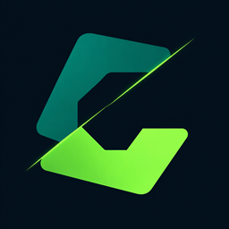
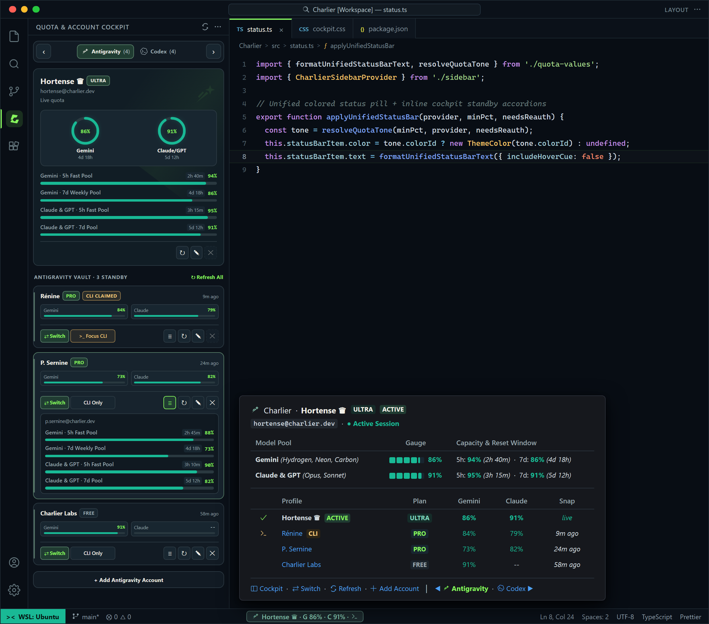

<div align="center">

<br/>



# Charlier

**Run multiple Codex & Antigravity CLI accounts at the exact same time. Hot-swap IDE sessions in `< 100ms` without ever restarting the VS Code Extension Host.**

*One pinned IDE Hero + unlimited parallel CLI accounts + live burn telemetry across Windows, macOS, and Linux. Zero runtime npm dependencies.*

<p>
  <a href="#cross-os-architecture"></a>
  <a href="#cross-os-architecture"></a>
  <a href="#cross-os-architecture"></a>
</p>
<p><sub>&middot;&nbsp;&nbsp;&nbsp;&middot;&nbsp;&nbsp;&nbsp;&middot;</sub></p>
<p>
  
  
  <a href="https://marketplace.visualstudio.com/items?itemName=Sernine.charlier"></a>
  <a href="https://open-vsx.org/extension/Sernine/charlier"></a>
</p>

</div>

<p align="center">
  
  
</p>

---

## Cut One Card. Keep the Whole Table Running.

Google Antigravity and OpenAI Codex assume one login per machine. Every existing VS Code switcher accepts that wall and throws a sledgehammer at your editor to swap accounts. Charlier broke both limits:

1. **Parallel Multi-Account CLI Concurrency**: Running two `codex` or `agy` accounts at once on one machine is supposed to be impossible because both lock onto a single global `~/.codex/auth.json`, `~/.gemini/`, and OS keyring. Charlier turns it into one click: keep **Account A pinned in your IDE** while running **Accounts B, C, and D side by side** in isolated integrated terminals via [`CLI Only` Mode](#multi-window--cli-concurrency-cli-only-mode). Each terminal boots in its own sandboxed home (`~/.gemini/charlier/cli-homes/`) with OS keyring bypass and automatic token sync-back. Zero collision.
2. **Surgical Single-Provider Hot-Swap**: Other switchers call `workbench.action.restartExtensionHost` or `reloadWindow`, knocking out your whole editor setup at once: language servers, debuggers, MCP servers, and every co-running AI assistant drop together. Charlier leaves VS Code untouched. It fires an instant live handoff on `codex app-server` (buffered stdio graft with automatic chat and Goal replay) or hot-hydrates `agy` in place (`HasAuthToken` + `antigravity.reconnect`). Hit `0%` mid-task, cut to Account B, and keep going in the exact same chat or Goal. Everything else keeps running.
3. **Sub-Second Speed & Live Burn Telemetry**: The Cockpit, Status Bar, and target provider sidebar flip together before your hand leaves the mouse, and your gauges stay live while you work: real-time turn-stream push on Codex, post-turn loopback sync on Antigravity, `60s` focused burn ticks across your active Hero and `CLI CLAIMED` terminals, and `5m` standby pulls without ever hitting Reload.

Named after the **Charlier pass**: the classic one-handed card cut that brings the bottom half of the deck cleanly to the top. Built under **Sernine**.

---

## How Charlier Compares

| Capability | Charlier | Typical Account Switchers | Manual Sign-Out / Sign-In |
| :--- | :--- | :--- | :--- |
| **Parallel CLI + IDE Accounts (`CLI Only`)** | **Yes** - run `codex --no-daemon` and `agy` on multiple accounts at once while IDE Hero stays pinned | **No** - global single-account lock; clobbers IDE login or collides in OS keyring | Manual env juggling |
| **Single-Provider Surgical Hot-Swap** | **Yes** - switches ONLY the provider you clicked; sibling AI extensions, LSPs, and debuggers stay live | **No** - restarts the entire VS Code Extension Host and drops every running agent | Full browser OAuth roundtrip |
| **Switch Handoff Latency** | **`~30ms` (Antigravity) / `~50ms` visual handoff (Codex, active chats & Goals stay live)** | `3s-8s` full Extension Host or window reload | `30s-60s` browser login + callback |
| **Antigravity 10-Minute Crash Wall** | **Bypassed** - zero-kill `HasAuthToken` hydration swaps back-to-back without tripping Google's 3-restart limit or killing sibling Antigravity windows | **Hits wall** - repeated process kills trip `recovery_budget_exhausted` and lock the sidebar | Manual full reload |
| **Google Auth Curveballs (`VERIFY NEEDED`)** | **Handled** - catches phone/QR verification gates, locks `CLI Only`, wires 1-click verify, and auto-heals | **Blind** - breaks silently or shows bogus cached quota | Manual troubleshooting |
| **Live Burn & Standby Telemetry** | **Yes** - real-time turn push + `60s` active & `CLI CLAIMED` ticks + `5m` direct HTTPS standby pulls | **No** - stale until manual reload, blind to inactive accounts | **No** |
| **Revocation-Safe Swaps & Auto-Save** | **Yes** - never fires server-side `account/logout`; auto-saves unsaved logins; serialized Codex RTR lock | **No** - invalidates sibling sessions or races single-use refresh tokens | **No** |
| **Multi-Provider in One Vault** | **Google Antigravity + OpenAI Codex** *(Claude & Kimi co-run aware, full vaults next)* | Single provider only | Separate logins everywhere |
| **Runtime Footprint & Win32 Security** | **0 npm deps**, zero PowerShell spawns, zero unsigned `.exe` droppers (**15 KB `#![no_std]` Rust N-API**) | Heavy SQLite WASM bundles, inline PowerShell scripts, or unsigned helpers | N/A |

---

## Under the Hood

### Single-Provider Hot-Swap (Zero Extension Host Restarts)

Neither provider was built to switch accounts inside a live editor. Restarting the Extension Host is the blunt shortcut; Charlier talks to each backend directly instead:

- **OpenAI Codex (Instant Handoff + Buffered Stdio Graft + Live Chat & Goal Replay)**: `openai.chatgpt` spawns `codex app-server` once at startup and shuts down permanently if that child exits, while `codex-rs` refuses to load a different account from disk. Inside the shared Node.js `ExtensionHostProcess`, Charlier pins liveness on the existing `ChildProcess` handle (re-binding automatically if Codex ever restarts), swaps a FIFO buffer onto `rootProc.stdin`, and pulses a 3-stage `account/updated` reset at `~15-50ms` in parallel with Cockpit repaint so the Codex sidebar flips immediately. Before reaping the old process (full Windows `.cmd`/`.bat` process-tree teardown and POSIX exit-tracked reaping), Charlier snapshots every loaded thread via `thread/loaded/list`, spawns a fresh `codex app-server` against the newly swapped `~/.codex/auth.json`, completes the MCP `initialize` handshake with the installed extension's version/capabilities, and silently replays `thread/resume` (`excludeTurns: true`) for every open chat and paused or `usage_limited` Goal before piping `stdout` and flushing queued JSON-RPC requests in order. Hit `0%` mid-task, cut to Account B, and keep going in the exact same chat or click Resume Goal with zero window reload. Post-switch quota refresh waits until the graft finishes, keeping single-use refresh tokens out of any race.
- **Google Antigravity (`~30ms` Zero-Kill In-Place Hydration Across Dual Windows)**: After swapping the target profile's `StoredToken` payload into the OS keyring and disk stores (preserving existing refresh tokens when disk OAuth is newer), Charlier sends `LanguageServerService/HasAuthToken` (`~13ms`) to the already-running local `agy --hub` daemon in parallel with Cockpit repaint. Inside `agy`, `HasAuthToken` bypasses cache and runs `syncWithStoredToken` (`TokenChanged` + `ResetCaches`) directly in memory. Charlier triggers `antigravity.reconnect` immediately on `200 OK` so the sidebar flips right alongside Cockpit, then verifies the active email asynchronously via `GetUserStatus`. Because nothing gets killed, even when you have **multiple VS Code windows running the Antigravity extension** (or Antigravity IDE alongside VS Code), switching in one window leaves your other windows planted on their open chats with zero destructive restart: sibling windows pick up the new profile cleanly in real time, and if a swap lands mid-request, Google's built-in retry absorbs the handoff.

### Antigravity's 10-Minute Backend Restart Limit (And How Charlier Beats It)

Both the **Antigravity VS Code extension** (`google.google-antigravity`) and **Antigravity IDE** guard the `agy` language server with a strict crash budget inside `AntigravityServerManager`: **`AUTO_RECOVER_MAX_ATTEMPTS = 3` restarts per `10 minutes`** (`1s`, `3s`, `9s` backoff).

- **Why naive process kills fail**: Sending `SIGTERM` to `agy` counts as an unexpected crash, not a clean reload. Do it a 4th time inside 10 minutes (`recovery_budget_exhausted`) and Antigravity stops recovering completely, locking the panel on `Couldn't load this view` until you reload the window. On Antigravity IDE specifically, the workbench also binds the daemon's port once at activation, so a respawn on a different port breaks IDE RPCs.
- **How Charlier avoids the wall**: In-place `HasAuthToken` hydration never kills `agy` and never changes its port. You can swap accounts back-to-back all day across the VS Code extension or Antigravity IDE without burning a single attempt of that 10-minute budget or tearing down chats in sibling windows.
- **Safe fallback**: If an older daemon build or missing keyring ever fails verification after `HasAuthToken`, Charlier falls back to a window-scoped daemon respawn capped at `2` kills per `10 minutes` (preserving a safety margin before the crash screen) and only prompts for a clean `~200ms` Extension Host reload if that fallback cap is hit, explicitly naming any co-running Codex, Claude, or Kimi sessions first.

---

## What It Ships

### 1. Night Cut Cockpit & Unified Status Bar
- **Unified Colored Status Bar Pill & `0ms` Details**: One pill (`priority: 501`), one click target (`0ms` QuickPick + `0ms` in-place Quota Details inspector + 1-click `workbench.hover.delay` tuning), and an instant hover matrix. Renders theme-adaptive <picture><source media="(prefers-color-scheme: light)" srcset="media/providers/antigravity-inline-forest-64.png" /></picture> **Antigravity** (`#92D6BE`) and scalloped <picture><source media="(prefers-color-scheme: light)" srcset="media/codex/codex-small-cobalt-64.png" /></picture> **Codex** (`#8DBCF6`) marks with a trailing `>_` badge (plus count) whenever background `CLI Only` terminals are running. Codex tints by the tighter of `5h` and `7d`, while Antigravity uses a tier-aware pool average, shifting tone at `15-49%` / `VERIFY NEEDED` (`#E8BA6F`), `1-14%` (`#E88585`), and `0%` / `RE-AUTH`.
- **Unified 2-Pool Antigravity Telemetry**: Built for Google's unified quota model (`Gemini 4`: `Hydrogen`, `Neon`, `Carbon` `5h` + `7d`; `Claude & GPT`: `Opus`, `Sonnet` `5h` + `7d`) across `Free`, `Pro`, and `Ultra`. Automatically sanitizes retired legacy Argon snapshots from disk so stale percentages never skew your Status Bar health or standby scoring, while lighting up extra pools dynamically if Google adds one upstream.
- **Codex Reset Credits Everywhere**: Surfaces available Codex rate-limit **Reset Credits** and credit balances across the Cockpit Hero header, directly on Standby card faces, inside expanded drawers, and as compact inline bolt pills on **both Active and Standby rows** in the Hover Matrix `Profile` column.
- **Live Burn Auto-Refresh & Retained Sync**: Codex applies `account/rateLimits/updated` pushes straight off stdout at `0ms` (reconciling mid-session credit spends automatically), Antigravity syncs right after conversation turns settle, and focused ticks (`charlier.autoRefreshInterval`, default `60s`, with Linux Wayland / macOS Spaces interaction liveness) keep Active Hero + `CLI CLAIMED` meters fresh every `60s` and unclaimed standbys every `5m`. Cockpit retains its webview context with sequence-guarded `postMessage` morphing so dials never re-spin or blink.
- **CLI Claimed Priority & `Best Standby` Failover (`NEXT UP`)**: Active accounts pin first in the Hover Matrix's 4-row cap (`+ N more in Cockpit` overflow), followed immediately by running `CLI CLAIMED` terminals so live CLIs never get buried under idle high-tier standbys, and clicking a claimed row focuses its running terminal instead of spawning duplicates. When your Hero drops `< 15%`, exhausts a primary pool (`Claude < 15%` even if `Gemini` is `90%`), or hits `RE-AUTH` / `VERIFY NEEDED`, **Healthy-Tier Bands** (`Ultra 50% > Pro 100% > Ultra 20% > Free 100%`) surface a 1-click **`⇄ Switch Best`** banner and **`NEXT UP`** / **`NEXT`** badges in `< 0.1ms`.
- **Tier Sorting, Inactive-Only Delete & `/` Search**: Unclaimed standbys sort by plan tier (`ULTRA > ENTERPRISE > PRO > TEAM > EDU > PLUS > API_KEY > FREE`), with collapsible `≡` pool drawers per card. Active Hero and `CLI CLAIMED` delete buttons (`✕`) stay locked with guidance tooltips to prevent post-delete re-detection loops, and decks with `6+` accounts unlock instant `/` filter search (`Esc` clears).

### 2. Auth Guardrails, Session Health & Background Quotas
- **Direct Background Cloud Code & `wham/usage` Engine**: Queries Google Cloud Code (`v1internal:loadCodeAssist`, `fetchAvailableModels`, `retrieveUserQuotaSummary` with unexpired token reuse + `401` remint retry) and OpenAI (`chatgpt.com/backend-api/wham/usage`, `~120ms`) directly over HTTPS for dormant accounts without touching your active IDE session.
- **Google Verification Gate (`VERIFY NEEDED`)**: Detects post-login Google phone/QR gates (`VALIDATION_REQUIRED` / `403 PERMISSION_DENIED` / `ineligibleTiers`) across gRPC-Web trailers, Cloud Code HTTPS, and daemon logs. Surfaces amber **`VERIFY NEEDED`** banners and badges across Cockpit, Hover Matrix, and Status Bar, wires 1-click **`Verify Account`**, locks `CLI Only` (`CLI Locked`) until verified in the IDE, and auto-heals to live quota once cleared.
- **Zero-Revocation Codex Swaps & RTR Serialization**: Never sends server-side `account/logout` RPCs that kill sibling refresh tokens. Serializes single-use Refresh Token Rotation (`inFlightOAuthRefresh`) per account and reads `CLI CLAIMED` homes strictly read-only so background polls never collide with a live CLI process.
- **Honest `RE-AUTH (stale)` Demotion & Clock Rollover**: Healthy standby pools automatically roll back to `100%` once their reset timestamp passes. Revoked or expired accounts (`invalid_grant`, `token_revoked`, `refresh_token_reused`) freeze rollover immediately, mute gauges to `#7E909B`, stamp `RE-AUTH` + `STALE`, and gate non-CLI switches with **`Switch & Start Re-Login`** vs **`Switch Only`**.
- **Pre-Switch Auto-Save & Sub-Second Login Watch**: Switching away from an unsaved IDE login backs it up to the vault with live quota first. Clicking **`+ Add Account`** clears the Hero dial on Click 1 and watches filesystem, SQLite (`state.vscdb`), and loopback endpoints to catch new sign-ins in `< 600ms`, popping a 1-click **`Save to Vault`** toast and **`UNSAVED ACTIVE SESSION`** banner without duplicates (`chatgpt_account_id` workspace-aware).

### 3. Per-Window Focus-Aware Auto-Switch
- **Independent Multi-Window Lifecycles (`charlier.autoSwitchProvider`)**: Moving between Antigravity and Codex editors, webviews, diff tabs, active `codex` / `agy` terminals, or turn streams flips both the Status Bar pill and Cockpit deck automatically (`"auto"` | `"off"`). Running Codex in one VS Code window while opening or chatting with Antigravity in another never cross-flips decks: each window verifies Antigravity conversation activity against its own local `agy --hub` (`GetAllCascadeTrajectories`), ignores idle startup annotation indexing and background brain split panes, and drops unfocused UI events. *(Bare sidebar icon clicks without tab, terminal, or stream activity emit no public VS Code Extension API event.)*
- **Workspace Memory, Host Primacy & `1.2s` Manual Pin**: Antigravity IDE always boots on Antigravity, while every VS Code workspace remembers its own deck independently in `workspaceState` (`selectedProviderByHost` only seeds brand-new workspaces). Auto-switches never overwrite saved defaults, manual clicks pin for `1.2s` (`manualProviderPinUntil`), and window-focus checks diff file `mtimeMs:size` fingerprints before touching network or daemon RPCs.

---

<a id="multi-window--cli-concurrency-cli-only-mode"></a>
## Multi-Window & CLI Concurrency (`CLI Only` Mode)

Clicking **`CLI Only`** on any standby card (or the terminal button in QuickPick, or **`Charlier: Switch Codex CLI Only`**) resolves your CLI binary across `chatgpt.cliExecutable` (`~/` aware), `PATH`, packaged `openai.chatgpt-*` bundles, `~/.gemini/bin`, and OS package managers (prompting cleanly if missing), then launches an isolated per-profile sandbox under `~/.gemini/charlier/cli-homes/`:

1. **IDE Stays Untouched**: Global `~/.codex/auth.json`, `~/.gemini/*`, OS keyrings, and active IDE sessions never change.
2. **Per-Profile Sandbox Homes**:
   - **OpenAI Codex**: Stages `CODEX_HOME` at `~/.gemini/charlier/cli-homes/codex/<profileId>` with `0600` `auth.json`, `cli_auth_credentials_store = "file"` in `config.toml`, and mirrored `skills`, `plugins`, `rules`, and `AGENTS.md`, then spawns `codex --no-daemon`.
   - **Google Antigravity**: Stages `~/.gemini/charlier/cli-homes/antigravity/<profileId>` with fresh `.gemini/antigravity-cli/antigravity-oauth-token`, `google_accounts.json`, `oauth_creds.json`, and isolated Linux `.xdg/` dirs, bypassing shared OS keyrings before spawning `agy`.
3. **Claim Tracking & Token Sync-Back**: The card badges **`CLI CLAIMED`** and flips to **`>_ Focus CLI`** (1 terminal per profile, zero duplicates). Closing or exiting releases the claim, re-running `codex` / `agy` in that shell re-claims it, and rotated CLI tokens sync back to the vault automatically.

---

## Provider Support & Roadmap

| Provider | Support | Roadmap & Capabilities |
| :---: | :---: | :--- |
| <br/>**Google Antigravity** | **Shipped** | Full IDE + isolated `agy` CLI vault (`Free` / `Pro` / `Ultra`), gRPC-Web daemon + Cloud Code HTTPS telemetry (`Gemini 4` [`Hydrogen`, `Neon`, `Carbon`] + `Claude & GPT` [`Opus`, `Sonnet`]), and `~30ms` zero-kill `HasAuthToken` hot-swap. |
| <br/>**OpenAI Codex** | **Shipped** | Full IDE + isolated `codex --no-daemon` vault (`Free` / `Plus` / `Pro` / `Team` / `Enterprise` / `Edu` / `API Key`), `~120ms` `wham/usage` HTTPS telemetry (`5h`, `7d`, `Code Review`, `Reset Credits`), RTR safety, and `~50ms` visual-handoff buffered stdio graft with live chat & Goal replay. |
| <br/>**Anthropic Claude Code** | **Planned** | Co-running `anthropic.claude-code` detection is live today. Next: multi-account Anthropic OAuth/session vault, session + weekly usage meters, single-extension hot-swap, and isolated `claude` CLI concurrency. |
| <br/>**Moonshot AI Kimi Code** | **Planned** | Co-running `moonshot-ai.kimi-code` / `kimi.kimi-code` detection is live today. Next: Kimi Code profile vault, live Moonshot quota telemetry in Cockpit, and isolated parallel `kimi` terminals. |
| <br/>**Standalone `charlier` CLI** | **Planned** | Zero-binary Node.js CLI (`npx charlier switch`, `charlier status`, `charlier quota`, `charlier exec`) sharing `~/.gemini/charlier/` for `tmux`, SSH, and Neovim workflows without an IDE open. |

### What's Cooking Next

- **Per-IDE-Window Profile Isolation**: Taking non-destructive multi-window workflows all the way to the endgame: pinning completely different Codex and Antigravity profiles to separate VS Code or Antigravity IDE windows at the exact same time via isolated per-window homes and PID-stamped leases, so parallel IDE windows never touch each other on disk, race single-use refresh tokens, or collide in the OS keyring.
- **Standalone `charlier` CLI & Expanding Vaults**: Zero-binary Node.js CLI (`npx charlier`) sharing `~/.gemini/charlier/` for `tmux`, SSH, and Neovim alongside full Anthropic Claude Code and Moonshot AI Kimi Code vaults.

---

<a id="cross-os-architecture"></a>
## Cross-OS Architecture & Clean Binaries

### Zero Shell Spawns & 15 KB `#![no_std]` Win32 Keyring
Windows extensions touching Credential Manager usually spawn hidden `powershell.exe` scripts, pull `node-gyp` C++ toolchains on install, or drop unsigned `.exe` helpers - classic triggers for behavioral antivirus and EDR alerts.

Charlier ships **zero runtime `npm` dependencies**, **zero shell credential workers**, and **zero unsigned `.exe` droppers**:
- **15 KB `#![no_std]` Rust Win32 N-API Addon (`native/wincred-win32-x64.node`)**: Linked with `-nostdlib` and zero external Rust crates, loaded in-process by the Extension Host (`< 10ms` roundtrips, zero child processes).
- **Minimal Win32 Surface**: Calls only `CredReadW`, `CredWriteW`, and `CredDeleteW` (`advapi32.dll`) plus `kernel32.dll` UTF-8/heap helpers with volatile secret zeroing - zero network, registry, or file access.
- **Auditable Source**: All 512 lines of Rust live in [`src-native/wincred/src/lib.rs`](src-native/wincred/src/lib.rs) (`npm run build:wincred`; contributors and users never need Rust installed unless editing the addon).

| OS | Antigravity Credential Store | OpenAI Codex Store | Surgical Hot-Swap & CLI Isolation |
| :---: | :--- | :--- | :--- |
| <br/>**Windows** | `Advapi32.dll` (`CredReadW`/`CredWriteW`/`CredDeleteW`) via 15 KB `#![no_std]` N-API + `cmdkey.exe` delete fallback + `~/.gemini/*.json` | `%USERPROFILE%\.codex\auth.json` (`0600`) + canonical `\\?\` keyring cleanup | **Codex**: buffered stdio graft (`codex.exe app-server`); isolated `CODEX_HOME` + `config.toml` for `CLI Only`.<br/>**Antigravity**: `~30ms` in-place `HasAuthToken` hydration; isolated `HOME`/`USERPROFILE` + `WSL_DISTRO_NAME` file store for `CLI Only`. |
| <br/>**macOS** | `/usr/bin/security` Keychain (`find-generic-password` / `add-generic-password -U`) + `~/.gemini/*.json` | `~/.codex/auth.json` (`0600`) + optional Keychain cleanup (`Codex Auth` / `codex`) | **Codex**: buffered stdio graft (`POSIX` lock wait); isolated `CODEX_HOME` for `CLI Only`.<br/>**Antigravity**: `~30ms` in-place `HasAuthToken` hydration; isolated `HOME` + `WSL_DISTRO_NAME` file store for `CLI Only`. |
| <br/>**Linux** | `secret-tool` (`libsecret` / D-Bus Secret Service) + headless `oauth_creds.json` & `jetski-standalone-oauth-token` fallback | `~/.codex/auth.json` (`0600`) + optional `secret-tool` cleanup | **Codex**: buffered stdio graft (`POSIX` lock wait); isolated `CODEX_HOME` for `CLI Only`.<br/>**Antigravity**: `~30ms` in-place `HasAuthToken` hydration; isolated `HOME` + `.xdg/` XDG dirs + D-Bus/Keyring unset for `CLI Only`. |

All vault snapshots stay local under `~/.gemini/charlier/` via atomic `0o600` temp-file writes and rename retries across Windows, macOS, and Linux.

---

## Quick Start

### Install
- **Antigravity / Open VSX**: Search **`Sernine.charlier`** in Extensions, or install from **[Open VSX](https://open-vsx.org/extension/Sernine/charlier)**.
- **VS Code Marketplace**: Install from **[Visual Studio Marketplace](https://marketplace.visualstudio.com/items?itemName=Sernine.charlier)** (`ext install Sernine.charlier`).
- **Manual `.vsix`**: Grab the latest release from **[GitHub Releases](https://github.com/prince-sernine/charlier/releases)** and run `Extensions: Install from VSIX...`.

### Use
1. **Open Cockpit or Hover Pill**: Click the Charlier card-cut icon in the Activity Bar, or hover the unified Status Bar pill in the bottom right.
2. **Flip Decks**: Click **`‹ Antigravity | Codex ›`** in Cockpit or **`◀ Antigravity · Codex ▶`** in the hover footer (view-only, zero reloads).
3. **Save, Swap, or Claim a CLI**: Click **`Save to Vault`** on an unsaved login, **`+ Add Account`** for a clean zero-revocation login slot, **`⇄ Switch`** to hot-swap the IDE, or **`CLI Only`** on any standby card to spawn an isolated terminal.

---

## Commands & Settings

### Command Palette (`Ctrl+Shift+P` / `Cmd+Shift+P`)

| Command | Title |
| :--- | :--- |
| `charlier.switchProfile` | **Charlier: Switch Profile** |
| `charlier.switchProvider` | **Charlier: Switch Provider Deck (Antigravity / Codex)** |
| `charlier.openCockpit` | **Charlier: Open Quota & Account Cockpit** |
| `charlier.switchCodexCliOnly` | **Charlier: Switch Codex CLI Only (Zero IDE Reload)** |
| `charlier.viewQuota` | **Charlier: View Quota & Model Limits** |
| `charlier.refreshQuota` | **Charlier: Refresh Limits** |
| `charlier.saveProfile` | **Charlier: Save Current Profile** |
| `charlier.addAccount` | **Charlier: Add New Account** |
| `charlier.verifyAccount` | **Charlier: Verify Account** |
| `charlier.renameProfile` | **Charlier: Rename Profile** |
| `charlier.deleteProfile` | **Charlier: Delete Profile** |
| `charlier.openVault` | **Charlier: Open Profiles Directory** |
| `charlier.restartExtensionHost` | **Charlier: Restart Extension Host (Soft Reload)** |
| `charlier.reloadWindow` | **Charlier: Reload Window** |

### Extension Settings

| Setting | Default | Description |
| :--- | :--- | :--- |
| `charlier.antigravitySurgicalReload` | `true` | Hot-hydrate the local `agy` daemon in place (`~30ms`, with window-scoped respawn fallback) on Antigravity switch instead of restarting the Extension Host. |
| `charlier.codexSurgicalReload` | `true` | Trigger an instant visual handoff (`~50ms`), buffered stdio graft, and in-memory thread/goal replay on `codex app-server` during Codex switch without restarting the Extension Host. |
| `charlier.showStatusBarQuota` | `true` | Show remaining pool percentages inline inside the unified Status Bar pill. |
| `charlier.autoRestartExtensionHost` | `true` | Soft-restart the Extension Host on switch when surgical hot-swap is disabled or no sibling provider is running. |
| `charlier.autoSwitchProvider` | `"auto"` | Automatically flip Status Bar and Cockpit when focusing Antigravity/Codex editors, tabs, turn streams, or CLI terminals (`"auto"` or `"off"`). |
| `charlier.autoRefreshInterval` | `60` | Seconds between focused quota ticks for the active Hero and `CLI CLAIMED` terminals (`30`-`3600`s; standbys refresh at `5x` cadence, min `5m`; `0` keeps real-time push only). |

### Themeable Status Bar Color Tokens

Customize pill colors in `settings.json` under `workbench.colorCustomizations`:

| Color Token | Dark | Light | High Contrast (Dark / Light) |
| :--- | :--- | :--- | :--- |
| `charlier.antigravityAccent` | `#92D6BE` | `#166F52` | `#9EF5D6` / `#0C593F` |
| `charlier.codexAccent` | `#8DBCF6` | `#1D5EA8` | `#AED2FF` / `#124685` |
| `charlier.quotaHealthy` | `#7FD6AE` | `#127A58` | `#8FF0C2` / `#0B5E42` |
| `charlier.quotaWarn` | `#E8BA6F` | `#9A6316` | `#FFD27D` / `#754808` |
| `charlier.quotaCritical` | `#E88585` | `#AD3D3D` | `#FF9A9A` / `#8A1F1F` |

---

## Vault Layout

All credentials stay local on your machine inside `~/.gemini/` and `~/.codex/`:

```text
~/.codex/
└── auth.json                                  # Active OpenAI Codex IDE credentials (0600)

~/.gemini/
├── google_accounts.json                       # Active Antigravity identity pointer
├── oauth_creds.json                           # Active Antigravity OAuth session
└── charlier/
    ├── state.json                             # Active profile, host-scoped deck preference (`selectedProviderByHost`), dismissed prompts
    ├── profiles/                              # Google Antigravity vault profiles
    │   └── <profile-id>/
    │       ├── metadata.json                  # Label, email, tier override, cached pools & auth state
    │       ├── keyring_credential.json        # StoredToken OS keyring payload backup (0600)
    │       ├── google_accounts.json           # Account identity store (0600)
    │       └── oauth_creds.json               # OAuth token store (0600)
    ├── providers/
    │   └── codex/
    │       └── profiles/                      # OpenAI Codex vault profiles
    │           └── <profile-id>/
    │               ├── metadata.json          # Label, email, account_id, cached wham/usage & auth state
    │               └── auth.json              # Full Codex OAuth / refresh_token store (0600)
    └── cli-homes/                             # Isolated per-profile CLI Only workspaces
        ├── antigravity/<profile-id>/          # File-backed token home (.gemini/antigravity-cli/)
        └── codex/<profile-id>/                # Dedicated CODEX_HOME + file-backed config.toml
```

---

## Build from Source

```bash
git clone https://github.com/prince-sernine/charlier.git
cd charlier
npm install
npm test
npm run package
```

Optionally rebuild the Win32 Credential Manager N-API addon (requires Rust only when editing `src-native/wincred/`):

```bash
npm run build:wincred
```

Install the generated `charlier-0.2.4.vsix` into VS Code or Antigravity IDE:

```bash
code --install-extension charlier-0.2.4.vsix --force
antigravity-ide --install-extension charlier-0.2.4.vsix --force
```

---

## License & Ownership

Copyright (c) 2026 **Sernine** ([@prince-sernine](https://github.com/prince-sernine)).

The source code is open so you can read every line that touches your credentials, build it locally for your own personal use, or send PRs back upstream. What you may not do is rip the code, switching architecture, keyring engine, or UI, slap a new name or icon on it, and re-upload a clone or competing derivative to the Visual Studio Marketplace, Open VSX, or another public registry or repo. See [`LICENSE`](LICENSE) and [`NOTICE`](NOTICE) for the full source-available terms and pseudonymous ownership record.
